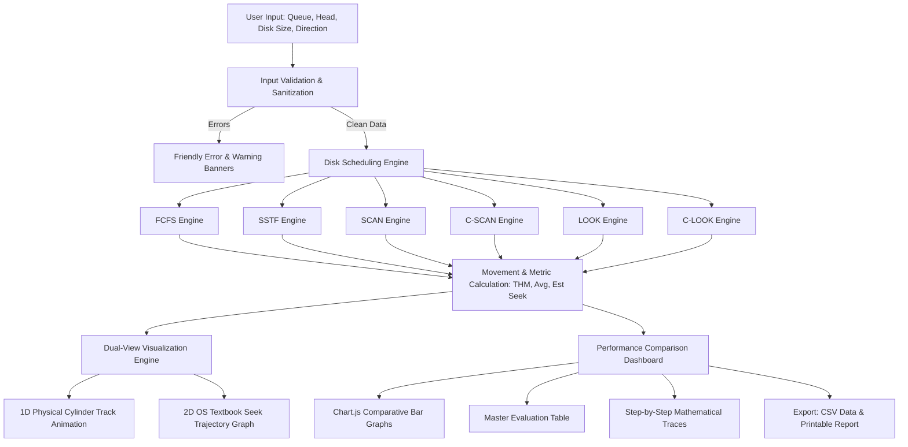

# Disk Scheduling Algorithm Simulator
## Performance Comparison and Visualization

An interactive, web-based simulation and visual evaluation suite for Operating Systems secondary storage disk scheduling algorithms.

Developed as an academic mini-project for the **Operating Systems course (1BCS304)**, **Department of Computer Science and Engineering**, **Seshadripuram Institute of Technology, Mysuru**, affiliated with **Visvesvaraya Technological University (VTU), Belagavi**.

---

## 🏛️ Project Details

| Parameter | Academic Detail |
| :--- | :--- |
| **Project Title** | Disk Scheduling Algorithms: Performance Comparison and Visualization |
| **Course Title** | Operating Systems |
| **Course Code** | 1BCS304 |
| **Institution** | Seshadripuram Institute of Technology, Mysuru |
| **Department** | Department of Computer Science and Engineering |
| **Academic Year** | 2026–2027 |
| **Affiliation** | Visvesvaraya Technological University (VTU), Belagavi |

### Project Team
1. **Shariffa Zainab** — USN: `4PQ25IS022` (Information Science & Engineering)
2. **Spoorthy CM** — USN: `4PQ25IS028` (Information Science & Engineering)

### Project Guide
- **Srinidhi H R**, Assistant Professor, Department of Computer Science and Engineering, Seshadripuram Institute of Technology, Mysuru

---

## 📌 Problem Statement

In magnetic Hard Disk Drives (HDDs), mechanical seek time—the physical movement of the read/write actuator arm across concentric platter cylinders—is the primary bottleneck in secondary storage input/output (I/O). A naive FIFO/FCFS request servicing order causes severe arm thrashing across wide track spans, significantly degrading system throughput and introducing latency spikes.

There is a vital educational need for an accurate, interactive software tool that models physical head trajectories, calculates mathematically verified seek metrics, and allows engineering students and faculty to compare all six standard scheduling algorithms side-by-side.

---

## 🎯 Objectives

1. **Accurate Mathematical Engine:** Implement all six classic disk scheduling algorithms (FCFS, SSTF, SCAN, C-SCAN, LOOK, C-LOOK) strictly adhering to OS theory with 0 hardcoded values.
2. **Interactive Platter & 2D Trajectory Visualizer:** Provide step-by-step animation of disk arm motion along both a 1D cylinder rail and a classic 2D seek trajectory graph (as illustrated in Silberschatz & Galvin textbooks).
3. **Comprehensive Performance Dashboard:** Evaluate and contrast Total Head Movement, Average Movement per Request, and Estimated Seek Time across all algorithms for any given workload.
4. **Tie & Fairness Detection:** Detect performance ties objectively without declaring arbitrary single winners; explain starvation risks and elevator mechanics.
5. **Academic Export & Reporting:** Enable one-click CSV export of full comparison results and clean, printable PDF reports for mini-project documentation and lab viva evaluations.

---

## 🛠️ Technology Stack

- **Frontend:** HTML5, CSS3 (Custom Dark Navy Engineering Theme), JavaScript (ES6+ Vanilla Modular Architecture)
- **Data Visualization:** Chart.js 4.4.x (Responsive Canvas Bar Charts), Custom SVG Trajectory Rendering
- **Development & Build Tooling:** Node.js, Vite 6.x
- **Testing:** Automated Node.js test runner covering 40 unit and edge-case verification tests
- **Version Control:** Git & GitHub

> **Zero Heavy Framework Overhead:** Runs 100% in modern web browsers without external database requirements, user logins, or paid third-party APIs.

---

## 📐 System Architecture & Workflow



---

## 🧠 Implemented Algorithms

### 1. FCFS (First Come First Serve)
- **Concept:** Services requests in their exact arrival sequence without reordering.
- **Complexity:** $O(N)$
- **Advantage:** Starvation-free, zero computational overhead.
- **Disadvantage:** Severe arm thrashing and high seek times.

### 2. SSTF (Shortest Seek Time First)
- **Concept:** Selects the pending request with the minimum seek distance from current head.
- **Complexity:** $O(N^2)$
- **Tie-Breaking Rule:** Prefers the cylinder in current movement direction; if still tied, selects the lower cylinder number.
- **Advantage:** Highly minimizes immediate seek distance.
- **Disadvantage:** Vulnerable to request starvation for distant tracks.

### 3. SCAN (Elevator Algorithm)
- **Concept:** Moves in one direction servicing requests until it hits the **physical disk boundary** ($0$ or $\text{diskSize} - 1$), reverses direction, and sweeps back.
- **Complexity:** $O(N \log N)$
- **Advantage:** Completely prevents starvation; smooth arm motion.

### 4. C-SCAN (Circular SCAN)
- **Concept:** Scans in one direction to the physical boundary, jumps directly to the opposite physical boundary without servicing requests on the return, and resumes scanning.
- **Complexity:** $O(N \log N)$
- **Advantage:** Provides uniform, fair waiting times for cylinders at both ends.

### 5. LOOK
- **Concept:** An optimized elevator algorithm that reverses immediately at the **last pending request** in the current direction, avoiding unnecessary seeks to empty disk boundaries.
- **Complexity:** $O(N \log N)$
- **Advantage:** Eliminates boundary seek waste of SCAN.

### 6. C-LOOK (Circular LOOK)
- **Concept:** Moves in one direction to the extreme pending request, jumps directly to the opposite extreme pending request, and continues in the original direction.
- **Complexity:** $O(N \log N)$
- **Advantage:** Combines the uniform wait times of C-SCAN with the boundary avoidance of LOOK.

---

## 📊 Verification Benchmark (VTU Specification)

- **Initial Head Position:** `50`
- **Disk Request Queue:** `82, 170, 43, 140, 24, 16, 190`
- **Total Cylinders:** `200` (Range: `0` to `199`)
- **Initial Direction:** `Right` (Increasing cylinders)

| Algorithm | Calculated Seek Sequence | Total Head Movement | Average Movement |
| :--- | :--- | :---: | :---: |
| **FCFS** | 50 → 82 → 170 → 43 → 140 → 24 → 16 → 190 | **642 cyl** | 91.71 cyl/req |
| **SSTF** | 50 → 43 → 24 → 16 → 82 → 140 → 170 → 190 | **208 cyl** | 29.71 cyl/req |
| **SCAN** | 50 → 82 → 140 → 170 → 190 → **199** → 43 → 24 → 16 | **332 cyl** | 47.43 cyl/req |
| **C-SCAN** | 50 → 82 → 140 → 170 → 190 → **199** → **0** → 16 → 24 → 43 | **391 cyl** | 55.86 cyl/req |
| **LOOK** | 50 → 82 → 140 → 170 → 190 → 43 → 24 → 16 | **314 cyl** | 44.86 cyl/req |
| **C-LOOK** | 50 → 82 → 140 → 170 → 190 → 16 → 24 → 43 | **341 cyl** | 48.71 cyl/req |

*(All calculations verified by automated unit tests in `tests/algorithms.test.js`).*

---

## 🚀 Installation and Local Execution

### Prerequisites
- Node.js (v18.0.0 or higher recommended)
- npm (v9.0.0 or higher)

### Setup Instructions

1. **Clone the Repository:**
   ```bash
   git clone https://github.com/<your-username>/Disk-Scheduling-Visualizer.git
   cd Disk-Scheduling-Visualizer
   ```

2. **Install Dependencies:**
   ```bash
   npm install
   ```

3. **Run Automated Unit Tests:**
   ```bash
   npm test
   ```
   *Expected Output: `TEST SUMMARY: 40 Passed, 0 Failed`.*

4. **Start Development Server:**
   ```bash
   npm run dev
   ```
   Open `http://localhost:5173/` in your browser.

5. **Build for Production Deployment:**
   ```bash
   npm run build
   ```
   Production assets will be built to the `dist/` directory.

---

## 🧪 Testing and Verification Suite

The project includes automated regression tests covering:
- Correctness of seek sequences and Total Head Movement across all 6 algorithms.
- Silberschatz classic OS textbook problem (Head: 53, Direction: Left).
- Edge cases: Initial head position present in request queue (0 distance).
- Duplicate cylinder requests.
- Requests at exact boundaries (cylinder 0 and diskSize - 1).
- Empty request queues and division-by-zero protection.
- Input validation sanitization and out-of-bounds rejection.

Run all tests via:
```bash
npm test
```

---

## 📄 Viva Preparation Material

For comprehensive viva examination preparation for the VTU Operating Systems course (1BCS304), refer to the dedicated [VIVA_QUESTIONS.md](file:///c:/Users/SHARIFFA%20ZAINAB/OneDrive/Documents/Desktop/Disk%20Scheduling/VIVA_QUESTIONS.md) document containing 25+ detailed questions, mathematical proofs, and model answers.
